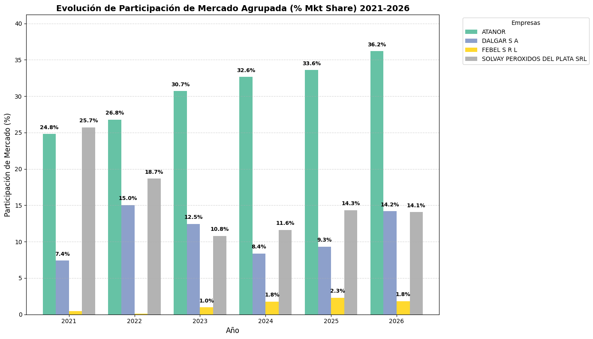

                     
## Proyecto

### TP-final-analisis-de-datos 📊

Curso: Herramientas básicas para Análisis de Datos - Centro UTN E-Learning
                                       
### Descripción general: Evolución del mercado argentino de peróxido de hidrógeno (2021-2026) 

Siendo uno de los mayores fabricantes de este insumo,es primordial monitorear nuestra posición en el mercado analizando periódicamente las importaciones de la posición arancelaria correspondiente, así como incluir con la mayor precisión posible las cantidades fabricadas en el país.   

🎯Objetivos principales: Hacer el seguimiento a lo largo de los últimos 5 años de los siguientes indicadores

### 1) Evolución del tamaño del mercado en toneladas y participación de cada empresa

### 2) Evolución de los precios y comparación frente a la competencia

### 3) Incidencia del costo logístico en el precio del producto y su comparación frente a competidores directos.

### Instrucciones de uso

Para ver criterios de clasificación y limpieza del dataset, junto con gráficas correr el siguiente enlace
*[Mkt Peróxido Argentino] (https://github.com/PADelucchi/herramientas-basicas-analisis-de-datos-Delucchi-Pablo/blob/d7296c638032d338f7c725b1b4cad25596433ac9/TP%20final.ipynb)



📂DATASET: (https://app.penta-transaction.com/login) se requiere contraseña pero ya se descargaron los datos en el archivo H2O2... xlsx presente en este repositorio.

🔍Resultados:  Es prioritario renegociar nuestros servicios logísticos, logrando una reducción mínima del 10%, así como también nuestros costos de producción, para ser más competitivos y adaptarnos a la realidad del mercado actual. Con estas medidas, volveremos al nivel mínimo de un Mkt Share del 15%


## Estructura de datos

├── H2O2 2021-Sep 2026_sucio(1).xlsx          : dataset estructurado obtenido de servicios aduaneros

├── MercadoPeroxlimpio(5).xlsx                : dataset limpio de filas nulas y anómalas luego de tratamiento en Colab con Python

├── Mkt perox Ene-Sep comparación.png         : Gráfica con cantidades del mercado con detalle de cada proveedor, para ver evolución y tendencia del mercado

├── Mkt share vs competencia directa.png      : Gráfica para ver nuestra posición frente a competidores

├── README.md                                 : Resumen de los puntos más importantes y acciones para mejorar

├── TP Final Dashboard.pbix                   : Principales KPIs respondiendo a los objetivos 

├── TP final.ipynb                            : Notebook en plataforma Colab utilizando Python para clasificar y extraer datos útiles para analizar las estadísticas de mercado

├── requirements.txt                          : Tecnologías para correr este modelado de datos

pip install-r requirements.txt                : instalación de librerias
```

🛠️Herramientas utilizadas: entorno Google Colab, Python, pandas, matplotlib, plotly, Power BI

Autor: Pablo Delucchi
